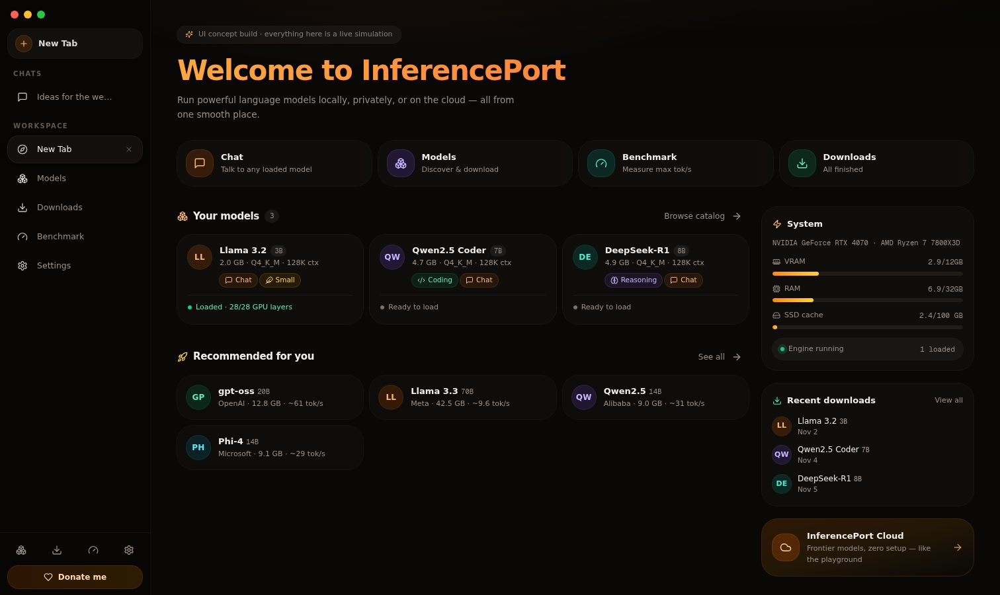
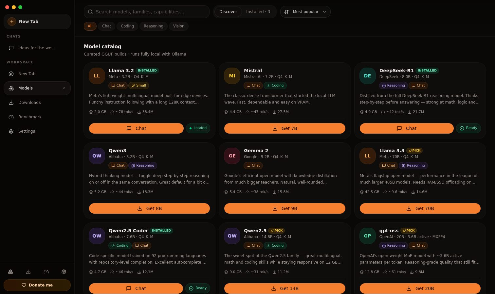
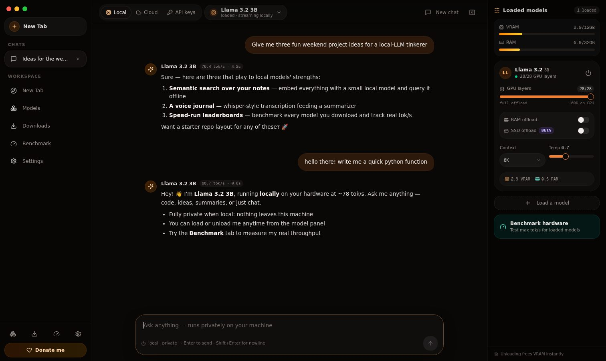
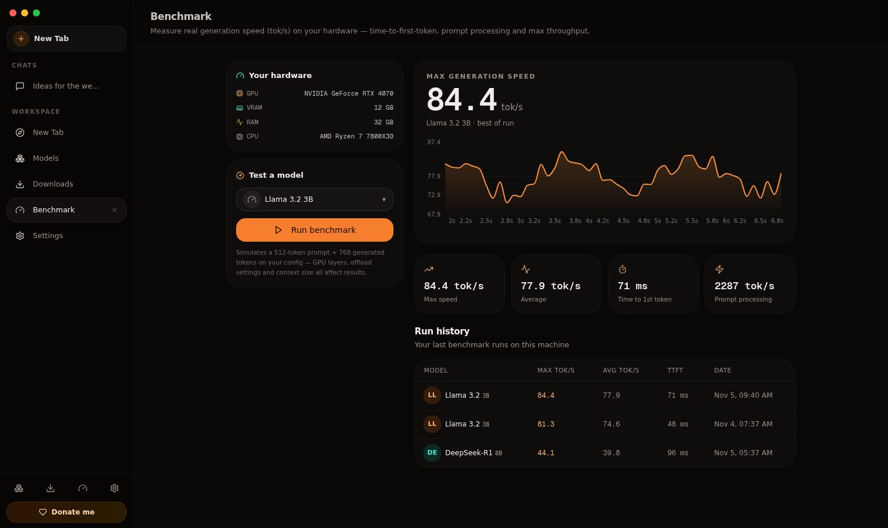

# UI Redesign — "Bionic" web renderer

This change adds a **redesigned interface** for InferencePort AI as a drop-in
web renderer. It is a UI/UX concept contribution: the complete new interface
is committed as a **pre-built static bundle** (`src/public/bionic/`), the
source lives in `src/webui/`, and the Electron main process gets a tiny,
fully reversible switch to load it.

> **Backend is 100% untouched.** No changes to `node-apis/`, `preload.cts`,
> the native Rust module, `build.config.js`, `package.json` or any build
> script. The packaged app gains one folder inside `public/` — nothing else.

---

## What it looks like

| Home (New Tab) | Model catalog |
| --- | --- |
|  |  |

| Chat with streaming reply | Benchmark results |
| --- | --- |
|  |  |

## Design direction

- **Browser-like shell with a vertical tab strip** (Arc / LM Studio inspired):
  every view — Home, Chat, Models, Downloads, Benchmark, Settings — opens as
  its own tab, closable and re-openable, with a persistent "New Tab" page.
- **Warm dark theme** with an orange accent, rounded geometry and spring
  animations (framer-motion) so the whole app feels fluid, not static.
- **Home page** aggregates everything: quick actions, downloaded models,
  recommendations and live system status, plus a **Donate** link in the
  footer.
- **Model download UX**: catalog with capability chips, quantization
  variants, live progress with speed/ETA, pause/resume/cancel and history.
- **Chat**: pick local models (load / unload inline, with GPU-layer and
  context controls), InferencePort cloud models, or bring-your-own
  OpenAI/Anthropic-compatible API keys.
- **Benchmark**: measures tokens/s of any loaded model with live chart and
  history.
- **Future-proofing surfaced in the UI**: GPU loading plus RAM / SSD
  offload options for VRAM-constrained models.

## How it is wired (and why it is safe)

```
src/
├── main.ts                  ← 2 call sites now use loadMainRenderer()
│                              + optional "View → Renderer" menu switch
├── public/bionic/           ← pre-built static bundle (committed) → ships in the exe
├── public/index.html        ← classic renderer, untouched, still the fallback
└── webui/                   ← Next.js source project (not part of the exe build)
```

- `loadMainRenderer()` loads `public/bionic/index.html` **only if it exists**;
  otherwise it loads the classic `public/index.html`. Delete the `bionic`
  folder and the app behaves exactly as before — the safest possible revert.
- `View → Renderer` menu lets anyone flip between the new and classic UI at
  runtime while evaluating.
- electron-builder already packs `public/**`, so the new renderer ships with
  the existing build config, unchanged.
- Deep links, auth flows, marketplace, snip overlay and every other window
  keep working exactly as before (all legacy pages remain in place).

## Building the app

Exactly like before — nothing changes for the build pipeline:

```bash
cd src
npm install
npm run build     # produces the Windows/macOS/Linux installers as usual
```

## Working on the web UI itself

```bash
cd src/webui
npm install
npm run dev             # http://localhost:3000
npm run build:electron  # rebuilds and syncs into ../public/bionic
```

Commit both the `src/webui` changes and the refreshed `src/public/bionic`
output in the same PR.

## Honest status / next steps

This is a **front-end concept build**: model downloads, chat streaming,
benchmarks and hardware stats are simulated client-side (mock catalog of 13
real model families, realistic timing curves). Wiring the screens to the real
`preload` / `node-apis` bridge is deliberately left as follow-up work so this
PR carries **zero behavioural risk** to the existing app.

Suggested follow-ups if the design is accepted:

1. Connect the catalog/downloads to the existing Ollama node-APIs.
2. Stream real chat through `chatStream.ts` (the composer, markdown
   renderer and session UI are ready).
3. Drive the benchmark view from real `systeminformation` + inference timing.
4. Replace simulated provider settings with the existing auth/policy APIs.
